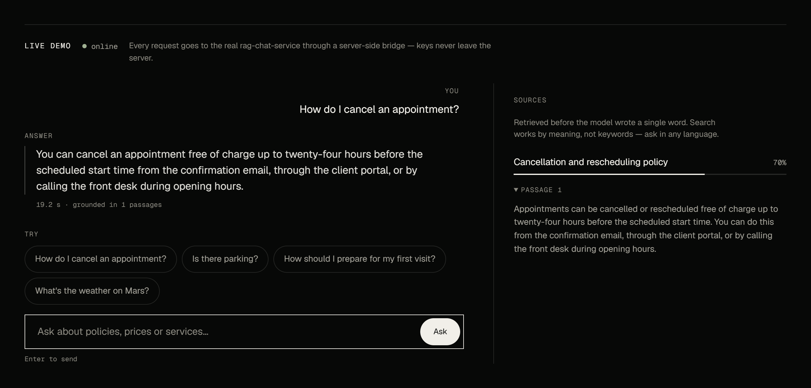

# RAG Chat Service

[](https://github.com/upkero/rag-chat-service/actions/workflows/ci.yml)
[](LICENSE)
[](https://www.python.org/downloads/)

*[Русская версия](README.ru.md)*

A thin Retrieval-Augmented-Generation chatbot built **on top of `ops-core-api`**. It
stores no documents of its own: on each question it (1) calls `ops-core-api`'s
`POST /api/v1/documents/search` to retrieve the most relevant document chunks, then
(2) asks an LLM to answer **strictly from that retrieved context**.



*The live demo: an answer grounded in one passage, with its source on the right.*

## Live demo

Try it at **[https://upkero.com](https://upkero.com)**. The demo runs this service as it
is in this repository, with:

| | Live configuration |
|---|---|
| Model | `openai/gpt-4o-mini`, through OpenRouter (`LLM_BASE_URL=https://openrouter.ai/api/v1`) |
| Reranker | Cohere `rerank-v3.5`, through OpenRouter (`RERANK_ENABLED=true`) |
| Knowledge base | `ops-core-api`, seeded with its demo documents |

The defaults in `.env.example` describe a cheaper local setup (Ollama, no reranker); the
two are the same code with different environment variables.

A hard business rule gates step 2: if the best chunk's `score` is below the active
threshold, the service returns a canned *"can't answer precisely, ask an administrator"*
message **without calling the LLM at all** — cost control plus honesty (no hallucinating
on weak retrieval). Which threshold is active depends on whether the optional
[reranker](#reranking-optional) is on:

| Reranker | Gate on the best chunk | `score` is |
|---|---|---|
| off (default) | `RAG_SCORE_THRESHOLD`, default `0.5` | cosine similarity from `ops-core-api` |
| on | `RERANK_MIN_SCORE`, default `0.08` | the cross-encoder's relevance score |

The gate is not the only refusal. A question that clears it can still have nothing
relevant in the context (small talk scores just above the rerank gate); the model then
answers with a `NO_ANSWER` marker, which the service swaps for the same canned message
with empty `sources`. That path **does** call the LLM. The canned message is Russian when
the question contains Cyrillic and English otherwise.

## Architecture

Layered architecture with a strict inward dependency rule (outer layers depend on
inner, never the reverse). Because this service persists nothing, it has **no database
layer** and therefore no `repositories/`: what would be one is a `gateways/` **Adapter**
onto `ops-core-api` behind the `KnowledgeGateway` port. A `repository` is a database
you own; a `gateway` is somebody else's service across a network — it can throttle you
or be down while your own process is perfectly healthy.

```
api/v1  (POST /api/v1/ask)
  └─ services    RagService: retrieve → (rerank) → confidence gate → generate
       ├─ interfaces/KnowledgeGateway ←impl─ gateways/OpsCoreKnowledgeGateway (HTTP Adapter)
       ├─ interfaces/Reranker         ←impl─ gateways/HttpReranker | LocalReranker (optional)
       └─ interfaces/LLMClient        ←impl─ llm/OpenAICompatibleLLMClient (OpenRouter / OpenAI / Ollama)
  llm/skills + prompts     one file per model job; every prompt is Markdown, in English
  messages                 text the user reads verbatim, per language
  core / exceptions / bootstrap (settings, JSON logging, DI container)
```

Patterns used (and commented in code): **Adapter** (HTTP client behind a data-access
shaped port), **Gateway** (`KnowledgeGateway`), **Factory**
(`create_ops_core_knowledge_gateway`, `create_llm_client`), and **Dependency Inversion**
(`RagService` depends only on interfaces, so tests swap in doubles). `RagService.ask` is
plain sequential code, not a framework with hooks: there is one flow and nothing
subclasses it.

Model-facing prose lives in `src/app/prompts/*.md` and nowhere else — English, with the
reply language as a `{reply_language}` placeholder rather than a translated copy of the
file. The rules are the `system` message; the retrieved excerpts and the question go in a
delimited `user` message and are declared to be data, not instructions. Text a user reads
verbatim is not a prompt and lives in `src/app/messages/`.

## Endpoint

`POST /api/v1/ask` — **requires** an `X-API-Key` header.

```jsonc
// request
{ "question": "how do I cancel an appointment" }

// response (reranker on; with it off `score` is the cosine similarity, e.g. 0.82)
{
  "answer": "You can cancel an appointment free of charge up to twenty-four hours before the scheduled start time.",
  "sources": [
    {
      "document_title": "Cancellation and rescheduling policy",
      "chunk_index": 0,
      "chunk_text": "Appointments can be cancelled or rescheduled free of charge up to twenty-four hours before the scheduled start time.",
      "score": 0.674
    }
  ]
}
```

`chunk_text` is the exact passage the model was given, so a client can show the source
without a second search. It was added after the first release; the other fields are
unchanged, so an existing client keeps working.

`sources` lists only the chunks the model was given: those at or above the active
threshold **and** at least half the best score. A weaker neighbour is neither cited nor
sent to the model. An empty `sources` means a refusal.

A blank question is a `422`; an exhausted own rate limit is a `429` with `Retry-After`.

The examples throughout this README quote `ops-core-api`'s seeded demo documents, so
they reproduce against a backend seeded with `uv run python -m src.app.cli.seed`.

Health probes (open, no key): `GET /health/live`, `GET /health/ready` (readiness
checks **both** the LLM and ops-core-api, returns 503 if either is down).

## Reranking (optional)

Embedding search compares two vectors that never saw each other. With
`RERANK_ENABLED=true` the service retrieves `RERANK_CANDIDATES` chunks (default 10),
lets a cross-encoder read the question and each chunk together, keeps the best
`RAG_MAX_CONTEXT_CHUNKS`, and gates on `RERANK_MIN_SCORE` instead of
`RAG_SCORE_THRESHOLD`.

- **Providers.** `RERANK_PROVIDER=http` (default) calls any Cohere-style
  `POST {RERANK_BASE_URL}/rerank` — OpenRouter by default, model `cohere/rerank-v3.5`,
  key in `RERANK_API_KEY`. `RERANK_PROVIDER=local` runs a sentence-transformers
  CrossEncoder (`RERANK_LOCAL_MODEL`, default `BAAI/bge-reranker-v2-m3`, about 2 GB of
  weights) in this process; it needs the image built with `LOCAL_MODELS=true`
  (CPU torch, about 1 GB more) and the model loads at boot.
- **Scale.** Rerank scores are not cosine similarities. On Cohere rerank-v3.5 relevant
  chunks scored 0.10–0.70 and clearly off-topic ones 0.04 or less; small talk lands
  around 0.05–0.10, which is why the `NO_ANSWER` path above exists. The `0.08` default
  is calibrated on Cohere: another reranker (the local model's sigmoid scores included)
  needs its own `RERANK_MIN_SCORE`.
- **Data flow.** With the `http` provider every question and the text of every candidate
  chunk is sent to `RERANK_BASE_URL` — OpenRouter, and from there Cohere. Leave
  reranking off (the default) if document text must not leave your infrastructure
  beyond the LLM call. The `local` provider sends nothing anywhere.
- **Failure.** A reranker that errors or answers with a malformed response is never
  fatal: the service logs a warning and falls back to the embedding order and
  `RAG_SCORE_THRESHOLD`.

## Observability

The service speaks OpenTelemetry; set `OTEL_EXPORTER_OTLP_ENDPOINT` and spans and metrics
are pushed to a collector. Unset, spans are still created so log lines carry `trace_id`.

- **Traces.** `rag.ask` wraps `rag.retrieve`, `rag.rerank` and the `chat <model>` span of the
  LLM call, with the outgoing `ops-core-api` and rerank calls as client spans. Only lengths,
  scores and outcomes are attributes: never the question or the answer.
- **Metrics.** `rag.answers{outcome,reranked}` (`answered`, `low_confidence_gate`,
  `model_no_answer`, `error`), `rag.top_score{scale}`, `rag.retrieval.chunks{stage}`,
  `rag.rerank.fallbacks`, `upstream.retries{target,reason}`, and the GenAI client metrics
  (duration, tokens, finish reasons).
- **Cost.** The LLM call asks OpenRouter for `usage.cost` and records it as `llm.cost` (USD)
  per model. The rerank call is costed the same way: OpenRouter's `/rerank` response
  carries `usage.cost` (0.001 USD a search for `cohere/rerank-v3.5`), recorded under the
  rerank model.
- **Logs.** One JSON line per request with the route template and duration, carrying
  `request_id`, `trace_id` and `span_id`. The request id is passed on to `ops-core-api`.

## Security

- **API-key auth** on every `/api/v1/*` route via the `X-API-Key` header
  (constant-time compare; `SECURITY_API_KEY`, min length 16). Missing/invalid → 401.
- **Rate limiting** per client IP (sliding window; `RATE_LIMIT_*`, default **20/min**) →
  429 when exceeded. 20 is not arbitrary: `ops-core-api` caps `/documents/search` at
  20/min and this service calls it exactly once per question, so a higher number here
  would only relocate the 429 to a worse place to read it. In-memory/per-process — use
  Redis for a shared limit across instances.
- **CORS** closed by default (`CORS_ALLOWED_ORIGINS` empty, comma-separated) — set
  origins explicitly; a browser client cannot call the service until you do.
- Secrets only via env (`SECURITY_API_KEY`, `OPS_CORE_API_KEY`, `LLM_API_KEY`,
  `RERANK_API_KEY`), held as `SecretStr` so they stay out of reprs and errors — none
  are hard-coded. `.env.example` ships the placeholder `change-me-min-16-chars`, which
  is shared by all five portfolio services so `cp .env.example .env` gives a working
  demo; it is rotated in all five at once, and replaced everywhere before deployment.

## Run locally

Prerequisites: a running **`ops-core-api`** (seeded with documents) and an
**OpenAI-compatible LLM** (OpenAI, or a local Ollama — Ollama is OpenAI-compatible).

```bash
cp .env.example .env          # then edit OPS_CORE_* and LLM_* values
docker compose up --build     # service on http://localhost:8001
```

`docker-compose.yml` runs only this service (port `8001` to avoid `ops-core-api`'s
`8000`; the `python -m src.main` entrypoint uses `8001` too). Point `OPS_CORE_BASE_URL` / `LLM_BASE_URL` at your backends; when they run on
the host, use `http://host.docker.internal:<port>`.

Without Docker:

```bash
uv sync
uv run uvicorn src.main:app --reload --port 8001
```

## Example requests

```bash
# The key from .env (the shared placeholder is change-me-min-16-chars)
export SECURITY_API_KEY=change-me-min-16-chars   # or: set -a; . ./.env; set +a

# In-topic question → grounded answer with its source
curl -sX POST http://localhost:8001/api/v1/ask \
  -H 'Content-Type: application/json' \
  -H "X-API-Key: $SECURITY_API_KEY" \
  -d '{"question": "how do I cancel an appointment"}'

# Off-topic question → canned fallback, LLM never called (see logs: "llm_skipped": true)
curl -sX POST http://localhost:8001/api/v1/ask \
  -H 'Content-Type: application/json' \
  -H "X-API-Key: $SECURITY_API_KEY" \
  -d '{"question": "what is the weather on mars"}'
```

## Tests

```bash
uv run pytest --cov=src/app/services --cov-report=term-missing --cov-fail-under=60
uv run ruff check .
uv run mypy src
```

Unit tests mock the `KnowledgeGateway` and `LLMClient` interfaces and cover both DoD
scenarios (confident answer with source; below-threshold rejection with no LLM call),
plus generate-phase failure handling and language fidelity. Integration tests drive
`POST /api/v1/ask` through `httpx.ASGITransport` with the service dependency
overridden — no real `ops-core-api` or LLM is contacted.

`tests/fixtures/error-codes.json` is a copy of `ops-core-api`'s generated error-code
contract; a test fails if a code this service emits stops existing upstream.

## Configuration

All configuration is via environment variables (see [`.env.example`](.env.example)):
`SECURITY_API_KEY` (auth), `RATE_LIMIT_*` (throttle), `OPS_CORE_BASE_URL` /
`OPS_CORE_API_KEY` / `OPS_CORE_TIMEOUT_SECONDS` / `OPS_CORE_MAX_ATTEMPTS` (upstream
connection; attempts are the TOTAL including the first), `RAG_*` (business rules incl.
the score threshold), `RERANK_*` (optional reranker: `ENABLED`, `PROVIDER`, `BASE_URL`,
`API_KEY`, `MODEL`, `LOCAL_MODEL`, `CANDIDATES`, `TIMEOUT_SECONDS`, `MIN_SCORE`),
`LOCAL_MODELS` (image build arg that bakes in sentence-transformers for
`RERANK_PROVIDER=local`), `LLM_*` (provider/model), `LOG_*`, and `CORS_ALLOWED_ORIGINS`.
Nothing is hard-coded; there is no database.

**Time budget.** A question can wait on a search (`OPS_CORE_TIMEOUT_SECONDS`, 10 s per
attempt), a rerank (`RERANK_TIMEOUT_SECONDS`, 10 s) and the model. The model call defaults
to `LLM_TIMEOUT_SECONDS=15` per attempt with `LLM_MAX_RETRIES=2`, so at most 45 s: with a
search that needs a second attempt and a rerank that times out, the whole question still
ends inside the 90 s the live site's bridge waits. Raising either LLM value for a slow
local model means checking that sum first.

## License

[MIT](LICENSE) © 2026 upkero
